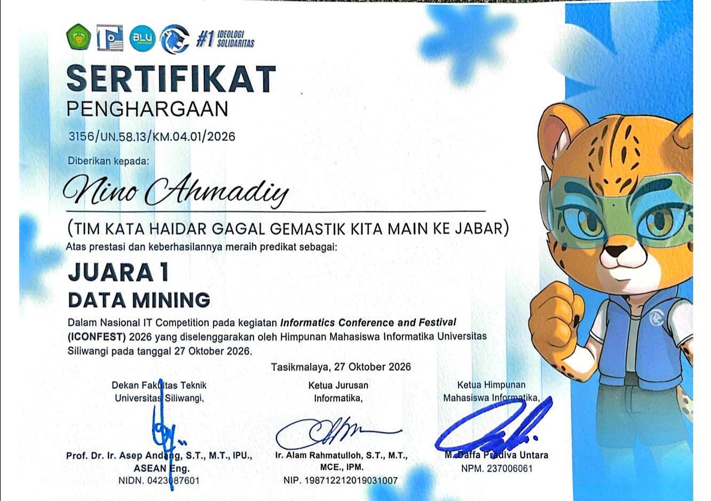

# ICONFEST 2026- JUARA 1 KATEGORI DATA MINING



**AneVision** adalah proyek estimasi kadar hemoglobin (Hb) dan skrining anemia melalui citra konjungtiva mata. Sistem menggabungkan **Ridge Regression** untuk mengestimasi Hb dengan **MobileNetV2 + Logistic Regression** untuk mengklasifikasikan anemia.

Repositori memuat kode pengolahan citra, pelatihan, inferensi, artefak model, serta laporan dan grafik evaluasi. Dataset mentah tidak disertakan.

> Model ditujukan untuk penelitian dan skrining edukatif. Hasil prediksi belum merupakan diagnosis atau pengganti pemeriksaan Hb laboratorium.

## Pendekatan Model

| Komponen | Masukan dan metode | Keluaran |
|---|---|---|
| Ridge Regression | 12 fitur citra RGB/LAB/HSV dan luas mask, ditambah indikator jenis kelamin; `StandardScaler` dan Ridge dengan `alpha=1.0` | Estimasi Hb dalam g/dL dan status berdasarkan ambang Hb |
| MobileNetV2 + Logistic Regression | Citra RGB 224 × 224; MobileNetV2 pralatih ImageNet sebagai ekstraktor beku, diikuti standardisasi dan Logistic Regression | Probabilitas serta status anemia dengan ambang probabilitas 0,5 |
| Gabungan | Aturan OR pada status kedua model | Status akhir anemia jika salah satu model menyatakan anemia |

Nilai Hb akhir selalu berasal dari Ridge. MobileNetV2 tidak menghasilkan estimasi Hb dan bobot backbone CNN tidak dilatih ulang pada dataset mata.

Ambang Hb yang diimplementasikan dalam proyek adalah **<12 g/dL untuk perempuan** dan **<13 g/dL untuk laki-laki**. Jenis kelamin juga menjadi salah satu masukan Ridge.

## Data

Menurut [laporan hasil](model-mata-github/HASIL_MODEL_MATA.md), proyek menggunakan dataset **Eyes-defy-anemia** dari bagian India dan Italia. Analisis akhir mencakup **211 pasien**, terdiri atas **90 pasien berlabel anemia** dan **121 berlabel normal** berdasarkan aturan proyek.

Pipeline memilih citra konjungtiva **forniceal** dan menghubungkannya dengan metadata Hb, jenis kelamin, dan usia. Usia tidak menjadi fitur model Ridge final.

Dataset dan foto uji lokal perlu diperoleh secara terpisah. Contoh tujuh foto uji dalam laporan tidak memiliki Hb laboratorium sebagai acuan, sehingga keluarannya merupakan pemeriksaan fungsi inferensi.

## Hasil Evaluasi

Evaluasi akhir dalam laporan menggunakan **5-fold StratifiedKFold**, `shuffle=True`, dan **`random_state=42`**, dengan label anemia sebagai dasar stratifikasi. Ridge dan MobileNetV2 memakai pasien serta pembagian fold yang sama. Scaler dan model prediksi di-fit hanya pada bagian train setiap fold; fitur MobileNetV2 berasal dari backbone beku.

| Model | MAE Hb (g/dL) | Akurasi | Sensitivitas anemia | F1 anemia |
|---|---:|---:|---:|---:|
| Ridge Regression | 1,2805 | 74,88% | 73,33% | 71,35% |
| MobileNetV2 + Logistic Regression | Tidak menghasilkan Hb | 73,46% | 80,00% | 72,00% |
| Gabungan | 1,2805 | 72,04% | 93,33% | 74,01% |

Tabel merangkum prediksi **out-of-fold (OOF)** yang digabungkan, bukan rata-rata skor antar-fold. Angka MAE berasal dari laporan dan belum dihitung ulang dari dataset. Angka klasifikasi telah dicocokkan dengan perhitungan dari matriks kebingungan yang dilaporkan; pemeriksaan ini tidak menjalankan ulang model.

Aturan gabungan meningkatkan sensitivitas, dengan konsekuensi positif palsu bertambah dari **29 pada Ridge** menjadi **53 pada gabungan**. Akurasi dan presisinya juga lebih rendah daripada Ridge saja.

Dari matriks kebingungan pada [berkas metrik MobileNetV2 per fold](model-mata-github/outputs/models/mobilenet_cv_metrics.json), rata-rata ± standar deviasi lima fold adalah:

| Metrik | Mean ± std |
|---|---:|
| Akurasi | 73,44% ± 2,90 poin persentase |
| Sensitivitas anemia | 80,00% ± 7,54 poin persentase |
| F1 anemia | 71,89% ± 3,38 poin persentase |

Ringkasan antar-fold tersebut dihitung dari matriks kebingungan tersimpan dengan standar deviasi populasi (`ddof=0`). Evaluasi kandidat pada `evaluation.py` menggunakan `KFold` teracak, sehingga angkanya perlu dibedakan dari evaluasi OOF berstratifikasi di atas.

## Berkas Utama

Kode berada dalam subfolder **`model-mata-github/`**.

| Lokasi | Fungsi |
|---|---|
| [requirements.txt](model-mata-github/requirements.txt) | Dependensi proyek |
| [config.py](model-mata-github/config.py) | Lokasi dataset, ambang, seed, dan direktori output |
| [data_loader.py](model-mata-github/data_loader.py) | Membaca metadata pasien |
| [image_processor.py](model-mata-github/image_processor.py), [feature_extraction.py](model-mata-github/feature_extraction.py) | Pemilihan citra, masking jaringan, dan ekstraksi fitur |
| [evaluation.py](model-mata-github/evaluation.py) | Evaluasi kandidat model dan susunan fitur |
| [train_final.py](model-mata-github/train_final.py) | Pelatihan dan penyimpanan model Ridge final |
| [train_mobilenet.py](model-mata-github/train_mobilenet.py) | Ekstraksi fitur MobileNetV2 dan pelatihan classifier |
| [inference.py](model-mata-github/inference.py) | Estimasi Hb dan klasifikasi dari citra |
| [plot_eye_metrics.py](model-mata-github/plot_eye_metrics.py) | Evaluasi OOF berpasangan dan kurva metrik |
| [outputs/models/](model-mata-github/outputs/models) | Artefak model dan metrik MobileNetV2 per fold |
| [outputs/plots/](model-mata-github/outputs/plots) | Grafik evaluasi dan eksplorasi agregat |
| [HASIL_MODEL_MATA.md](model-mata-github/HASIL_MODEL_MATA.md) | Laporan metode, hasil, dan keterbatasan |

## Instalasi

Clone repositori, masuk ke direktori kode, lalu pasang dependensi:

```bash
git clone https://github.com/Madeysszz/ICONFEST26_DATAMINING_AneVision.git
cd ICONFEST26_DATAMINING_AneVision/model-mata-github
python -m pip install -r requirements.txt
```

Dependensi mencakup NumPy, pandas, OpenCV, scikit-image, scikit-learn, TensorFlow, Matplotlib, joblib, dan openpyxl. Ikuti batasan versi pada `requirements.txt`, termasuk `scikit-learn==1.9.0` dan `tensorflow>=2.16,<3`.

## Inferensi

Jalankan contoh Python berikut dari direktori `model-mata-github`. Masukkan path citra konjungtiva yang tersedia di komputer Anda, dan sesuaikan `gender` dengan jenis kelamin pasien: `F` untuk perempuan atau `M` untuk laki-laki.

```python
import cv2
from inference import predict_from_image

image_path = input("Path citra konjungtiva: ")
image_bgr = cv2.imread(image_path)
prediction = predict_from_image(image_bgr, gender="F")
print(prediction)
```

Input fungsi adalah array citra **BGR**, seperti keluaran `cv2.imread`. Inferensi memakai artefak yang disertakan dalam `outputs/models/` dan tidak memerlukan dataset pelatihan.

| Field keluaran | Arti |
|---|---|
| `hgb_predicted` | Estimasi Hb dari Ridge, dalam g/dL |
| `status` | Keputusan akhir `Anemia` atau `Normal` |
| `status_ridge` | Keputusan berdasarkan estimasi Hb Ridge |
| `status_cnn`, `cnn_probability` | Status dan probabilitas classifier CNN; tersedia jika jalur CNN berhasil dimuat |
| `models_disagree` | Menandai perbedaan keputusan kedua model |
| `source` | `ensemble_Ridge+MobileNetV2` atau `Ridge_only` |
| `confidence` | Skor buatan dari margin Hb dan probabilitas classifier; belum dikalibrasi sebagai kepastian klinis |

Jika pemuatan model CNN gagal, inferensi dapat memakai Ridge saja; periksa `source`. Input gambar yang tidak valid atau tidak menghasilkan fitur dapat mengembalikan dictionary dengan field `error`.

## Pelatihan Ulang

Sediakan dataset dengan folder `India/` dan `Italy/`, masing-masing berisi `India.xlsx` atau `Italy.xlsx` serta subfolder nomor pasien dengan citra yang namanya mengandung `forniceal`. Pemuat MobileNetV2 membaca metadata `Number`, `Hgb`, `Gender`, dan `Age`.

Lokasi default adalah `model-mata-github/data/dataset anemia/`. Alternatifnya, tetapkan variabel lingkungan `EYES_DEFY_ANEMIA_DATASET`. Contoh PowerShell berikut dijalankan dari `model-mata-github`:

```powershell
$env:EYES_DEFY_ANEMIA_DATASET = Read-Host "Folder dataset Eyes-defy-anemia"
python evaluation.py
python train_final.py
python train_mobilenet.py
python plot_eye_metrics.py
```

Skrip pelatihan menulis ulang artefak pada `outputs/models/`. Gunakan salinan repositori jika ingin mempertahankan artefak yang disertakan.

## Keterbatasan dan Reproduksibilitas

- Evaluasi utama merupakan validasi internal OOF pada dataset yang sama, belum pengujian pada kohort eksternal berlabel Hb.
- Kondisi pengambilan citra memengaruhi kesesuaian input; performa pada foto ponsel dengan kondisi bebas belum dibuktikan oleh evaluasi berlabel dalam laporan.
- Heatmap berbasis warna jaringan pada skrip visualisasi bukan Grad-CAM atau atribusi keputusan MobileNetV2.
- Dokumentasi ini disusun melalui pembacaan kode, laporan, dan berkas metrik. Instalasi dependensi, pemuatan artefak, inferensi, dan pelatihan belum dijalankan ulang.

Rincian metode, matriks kebingungan, serta batasan interpretasi tersedia pada [laporan hasil model mata](model-mata-github/HASIL_MODEL_MATA.md).
# ICONFEST 2026- JUARA 1 KATEGORI DATA MINING

**AneVision** adalah proyek estimasi kadar hemoglobin (Hb) dan skrining anemia melalui citra konjungtiva mata. Sistem menggabungkan **Ridge Regression** untuk mengestimasi Hb dengan **MobileNetV2 + Logistic Regression** untuk mengklasifikasikan anemia.

Repositori memuat kode pengolahan citra, pelatihan, inferensi, artefak model, serta laporan dan grafik evaluasi. Dataset mentah tidak disertakan.

> Model ditujukan untuk penelitian dan skrining edukatif. Hasil prediksi belum merupakan diagnosis atau pengganti pemeriksaan Hb laboratorium.

## Pendekatan Model

| Komponen | Masukan dan metode | Keluaran |
|---|---|---|
| Ridge Regression | 12 fitur citra RGB/LAB/HSV dan luas mask, ditambah indikator jenis kelamin; `StandardScaler` dan Ridge dengan `alpha=1.0` | Estimasi Hb dalam g/dL dan status berdasarkan ambang Hb |
| MobileNetV2 + Logistic Regression | Citra RGB 224 × 224; MobileNetV2 pralatih ImageNet sebagai ekstraktor beku, diikuti standardisasi dan Logistic Regression | Probabilitas serta status anemia dengan ambang probabilitas 0,5 |
| Gabungan | Aturan OR pada status kedua model | Status akhir anemia jika salah satu model menyatakan anemia |

Nilai Hb akhir selalu berasal dari Ridge. MobileNetV2 tidak menghasilkan estimasi Hb dan bobot backbone CNN tidak dilatih ulang pada dataset mata.

Ambang Hb yang diimplementasikan dalam proyek adalah **<12 g/dL untuk perempuan** dan **<13 g/dL untuk laki-laki**. Jenis kelamin juga menjadi salah satu masukan Ridge.

## Data

Menurut [laporan hasil](model-mata-github/HASIL_MODEL_MATA.md), proyek menggunakan dataset **Eyes-defy-anemia** dari bagian India dan Italia. Analisis akhir mencakup **211 pasien**, terdiri atas **90 pasien berlabel anemia** dan **121 berlabel normal** berdasarkan aturan proyek.

Pipeline memilih citra konjungtiva **forniceal** dan menghubungkannya dengan metadata Hb, jenis kelamin, dan usia. Usia tidak menjadi fitur model Ridge final.

Dataset dan foto uji lokal perlu diperoleh secara terpisah. Contoh tujuh foto uji dalam laporan tidak memiliki Hb laboratorium sebagai acuan, sehingga keluarannya merupakan pemeriksaan fungsi inferensi.

## Hasil Evaluasi

Evaluasi akhir dalam laporan menggunakan **5-fold StratifiedKFold**, `shuffle=True`, dan **`random_state=42`**, dengan label anemia sebagai dasar stratifikasi. Ridge dan MobileNetV2 memakai pasien serta pembagian fold yang sama. Scaler dan model prediksi di-fit hanya pada bagian train setiap fold; fitur MobileNetV2 berasal dari backbone beku.

| Model | MAE Hb (g/dL) | Akurasi | Sensitivitas anemia | F1 anemia |
|---|---:|---:|---:|---:|
| Ridge Regression | 1,2805 | 74,88% | 73,33% | 71,35% |
| MobileNetV2 + Logistic Regression | Tidak menghasilkan Hb | 73,46% | 80,00% | 72,00% |
| Gabungan | 1,2805 | 72,04% | 93,33% | 74,01% |

Tabel merangkum prediksi **out-of-fold (OOF)** yang digabungkan, bukan rata-rata skor antar-fold. Angka MAE berasal dari laporan dan belum dihitung ulang dari dataset. Angka klasifikasi telah dicocokkan dengan perhitungan dari matriks kebingungan yang dilaporkan; pemeriksaan ini tidak menjalankan ulang model.

Aturan gabungan meningkatkan sensitivitas, dengan konsekuensi positif palsu bertambah dari **29 pada Ridge** menjadi **53 pada gabungan**. Akurasi dan presisinya juga lebih rendah daripada Ridge saja.

Dari matriks kebingungan pada [berkas metrik MobileNetV2 per fold](model-mata-github/outputs/models/mobilenet_cv_metrics.json), rata-rata ± standar deviasi lima fold adalah:

| Metrik | Mean ± std |
|---|---:|
| Akurasi | 73,44% ± 2,90 poin persentase |
| Sensitivitas anemia | 80,00% ± 7,54 poin persentase |
| F1 anemia | 71,89% ± 3,38 poin persentase |

Ringkasan antar-fold tersebut dihitung dari matriks kebingungan tersimpan dengan standar deviasi populasi (`ddof=0`). Evaluasi kandidat pada `evaluation.py` menggunakan `KFold` teracak, sehingga angkanya perlu dibedakan dari evaluasi OOF berstratifikasi di atas.

## Berkas Utama

Kode berada dalam subfolder **`model-mata-github/`**.

| Lokasi | Fungsi |
|---|---|
| [requirements.txt](model-mata-github/requirements.txt) | Dependensi proyek |
| [config.py](model-mata-github/config.py) | Lokasi dataset, ambang, seed, dan direktori output |
| [data_loader.py](model-mata-github/data_loader.py) | Membaca metadata pasien |
| [image_processor.py](model-mata-github/image_processor.py), [feature_extraction.py](model-mata-github/feature_extraction.py) | Pemilihan citra, masking jaringan, dan ekstraksi fitur |
| [evaluation.py](model-mata-github/evaluation.py) | Evaluasi kandidat model dan susunan fitur |
| [train_final.py](model-mata-github/train_final.py) | Pelatihan dan penyimpanan model Ridge final |
| [train_mobilenet.py](model-mata-github/train_mobilenet.py) | Ekstraksi fitur MobileNetV2 dan pelatihan classifier |
| [inference.py](model-mata-github/inference.py) | Estimasi Hb dan klasifikasi dari citra |
| [plot_eye_metrics.py](model-mata-github/plot_eye_metrics.py) | Evaluasi OOF berpasangan dan kurva metrik |
| [outputs/models/](model-mata-github/outputs/models) | Artefak model dan metrik MobileNetV2 per fold |
| [outputs/plots/](model-mata-github/outputs/plots) | Grafik evaluasi dan eksplorasi agregat |
| [HASIL_MODEL_MATA.md](model-mata-github/HASIL_MODEL_MATA.md) | Laporan metode, hasil, dan keterbatasan |

## Instalasi

Clone repositori, masuk ke direktori kode, lalu pasang dependensi:

```bash
git clone https://github.com/Madeysszz/ICONFEST26_DATAMINING_AneVision.git
cd ICONFEST26_DATAMINING_AneVision/model-mata-github
python -m pip install -r requirements.txt
```

Dependensi mencakup NumPy, pandas, OpenCV, scikit-image, scikit-learn, TensorFlow, Matplotlib, joblib, dan openpyxl. Ikuti batasan versi pada `requirements.txt`, termasuk `scikit-learn==1.9.0` dan `tensorflow>=2.16,<3`.

## Inferensi

Jalankan contoh Python berikut dari direktori `model-mata-github`. Masukkan path citra konjungtiva yang tersedia di komputer Anda, dan sesuaikan `gender` dengan jenis kelamin pasien: `F` untuk perempuan atau `M` untuk laki-laki.

```python
import cv2
from inference import predict_from_image

image_path = input("Path citra konjungtiva: ")
image_bgr = cv2.imread(image_path)
prediction = predict_from_image(image_bgr, gender="F")
print(prediction)
```

Input fungsi adalah array citra **BGR**, seperti keluaran `cv2.imread`. Inferensi memakai artefak yang disertakan dalam `outputs/models/` dan tidak memerlukan dataset pelatihan.

| Field keluaran | Arti |
|---|---|
| `hgb_predicted` | Estimasi Hb dari Ridge, dalam g/dL |
| `status` | Keputusan akhir `Anemia` atau `Normal` |
| `status_ridge` | Keputusan berdasarkan estimasi Hb Ridge |
| `status_cnn`, `cnn_probability` | Status dan probabilitas classifier CNN; tersedia jika jalur CNN berhasil dimuat |
| `models_disagree` | Menandai perbedaan keputusan kedua model |
| `source` | `ensemble_Ridge+MobileNetV2` atau `Ridge_only` |
| `confidence` | Skor buatan dari margin Hb dan probabilitas classifier; belum dikalibrasi sebagai kepastian klinis |

Jika pemuatan model CNN gagal, inferensi dapat memakai Ridge saja; periksa `source`. Input gambar yang tidak valid atau tidak menghasilkan fitur dapat mengembalikan dictionary dengan field `error`.

## Pelatihan Ulang

Sediakan dataset dengan folder `India/` dan `Italy/`, masing-masing berisi `India.xlsx` atau `Italy.xlsx` serta subfolder nomor pasien dengan citra yang namanya mengandung `forniceal`. Pemuat MobileNetV2 membaca metadata `Number`, `Hgb`, `Gender`, dan `Age`.

Lokasi default adalah `model-mata-github/data/dataset anemia/`. Alternatifnya, tetapkan variabel lingkungan `EYES_DEFY_ANEMIA_DATASET`. Contoh PowerShell berikut dijalankan dari `model-mata-github`:

```powershell
$env:EYES_DEFY_ANEMIA_DATASET = Read-Host "Folder dataset Eyes-defy-anemia"
python evaluation.py
python train_final.py
python train_mobilenet.py
python plot_eye_metrics.py
```

Skrip pelatihan menulis ulang artefak pada `outputs/models/`. Gunakan salinan repositori jika ingin mempertahankan artefak yang disertakan.

## Keterbatasan dan Reproduksibilitas

- Evaluasi utama merupakan validasi internal OOF pada dataset yang sama, belum pengujian pada kohort eksternal berlabel Hb.
- Kondisi pengambilan citra memengaruhi kesesuaian input; performa pada foto ponsel dengan kondisi bebas belum dibuktikan oleh evaluasi berlabel dalam laporan.
- Heatmap berbasis warna jaringan pada skrip visualisasi bukan Grad-CAM atau atribusi keputusan MobileNetV2.
- Dokumentasi ini disusun melalui pembacaan kode, laporan, dan berkas metrik. Instalasi dependensi, pemuatan artefak, inferensi, dan pelatihan belum dijalankan ulang.

Rincian metode, matriks kebingungan, serta batasan interpretasi tersedia pada [laporan hasil model mata](model-mata-github/HASIL_MODEL_MATA.md).
